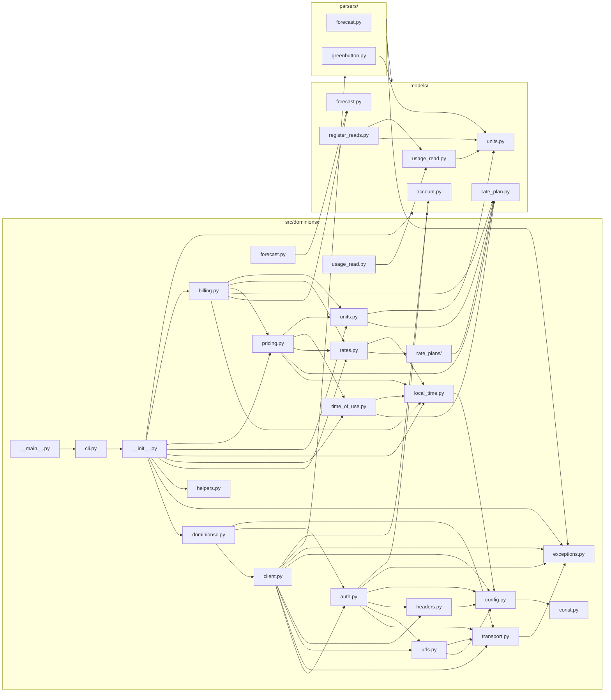

# Component & Package Architecture

## Package Structure (Grounded in `src/dominionsc/`)

```text
src/dominionsc/
  __init__.py          # public API: DominionSC, exceptions, models, rate plans and lookups, create_cookie_jar
  py.typed             # PEP 561 marker (inline type information)
  dominionsc.py        # backward-compatible import path (re-exports DominionSC, DominionSCTFAHandler, DominionSCURLHandler)
  auth.py              # login sequence (LoginFlow), verification-token scraping, TFA handler
  client.py            # DominionSC class
  cli.py               # argparse + CSV output
  transport.py         # DominionSCURLHandler (aiohttp request wrapper) and cache_buster()
  urls.py              # endpoint URL construction
  headers.py           # HTTP header helpers
  config.py            # UtilityConfig (endpoints, timezone, pilot ID, User-Agent) and DEFAULT_CONFIG
  const.py             # constants (USER_AGENT, BIDGELY_PILOT_ID)
  exceptions.py        # InvalidAuth, MfaChallenge, etc.
  forecast.py          # backward-compatible re-export of models.forecast.Forecast
  helpers.py           # create_cookie_jar()
  usage_read.py        # backward-compatible re-export of models.usage_read.UsageRead
  rates.py             # public rate plan entry point: assembles the plans, mappings, history, and lookups
  rate_plans/          # one module per plan (rate_1.py ... rate_32v.py) plus _common.py for shared values
  time_of_use.py       # get_time_of_use_rate(), TimeOfUseRate, season_for()
  local_time.py        # UTILITY_TIMEZONE, utility_local_date(), to_utility_local()
  units.py             # to_billing_units(), DEFAULT_THERMS_PER_CCF (re-exports MeterUnit)
  pricing.py           # price_usage(), rate_at(), price_net_usage(), RateQuote, UsageCost, NetUsageCost
  billing.py           # BillingCycle, estimate_billing_cycles(), find_billing_cycle(), fixed_charges(), UsagePricer
  __main__.py          # entry point delegating to cli.main()

  models/
    account.py         # AccountInfo / account model
    forecast.py        # Forecast model
    register_reads.py  # Per-register read model
    usage_read.py      # Usage read model
    rate_plan.py       # RatePlan type system (discriminated Charge union)
    units.py           # MeterUnit (Wh, ft³)
    __init__.py

  parsers/
    forecast.py        # Forecast parser
    greenbutton.py     # ESPI greenbutton XML parser
    __init__.py
```

## Package Diagram

Arrows show imports.



## Component Responsibilities

| Component | Key Symbol / Class | Responsibility |
| --- | --- | --- |
| `auth.py` | `LoginFlow`, `DominionSCTFAHandler`, `find_verification_token()` | Multi-step Dominion + Bidgely login, CSRF verification-token extraction, and the interactive TFA flow (options, code delivery, code verification). Session cookies are held by the caller's `aiohttp` session, not by this module |
| `client.py` | `DominionSC` | Main API facade; async methods (`async_login`, `async_get_accounts`, `async_get_forecast`, `async_get_register_reads`, `async_get_usage_reads`) |
| `cli.py` | `build_parser()`, `run()`, `main()` | Argument parsing; CSV output; loop over accounts |
| `transport.py` | `DominionSCURLHandler`, `cache_buster()` | Wraps a caller-supplied `aiohttp.ClientSession` for GET/POST with a 30-second default timeout and converts `ClientError` into `CannotConnect` |
| `urls.py` | URL builder functions | Endpoint paths for login, account, forecast, and Bidgely (`wc-session`, `gb-download`) endpoints |
| `headers.py` | Header builder functions | Fresh header dicts for Dominion page/AJAX calls and Bidgely calls; the only place the Bidgely pilot ID header is set |
| `config.py` / `const.py` | `UtilityConfig`, `DEFAULT_CONFIG`, `USER_AGENT`, `BIDGELY_PILOT_ID` | Endpoints, timezone, pilot ID, and User-Agent in one place |
| `exceptions.py` | `CannotConnect`, `InvalidAuth`, `MfaChallenge`, `ApiException` | Exception hierarchy; `CannotConnect` and `ApiException` carry `url`, `status`, and `response_text` |
| `helpers.py` | `create_cookie_jar()` | Cookie jar that does not percent-encode Dominion's cookie values |
| `parsers/greenbutton.py` | `parse_registers()`, `parse_usage_reads()` | Parses ESPI `UsagePoint` XML into register-level reads, applying the feed's `powerOfTenMultiplier` scaling and setting each read's `unit` from `espi:uom` |
| `parsers/forecast.py` | `parse_forecast()` | Parses forecast responses into cost/projections |
| `models/` | Dataclasses and enums | Structured output (`AccountInfo`, `RegisterReads`, `UsageRead`, `Forecast`, `RatePlan`, `MeterUnit`) |
| `rates.py` | `RATE_1`...`RATE_8`, `RATE_32S`, `RATE_32V`, `RATE_1_2025`, `RATE_2_2025`, `RATE_5_2024`, `RATE_5_2025`, `RATE_6_2025`, `RATE_7_2025`, `RATE_8_2025`, `RATE_32S_2025`, `RATE_32V_2025`, `RATE_PLAN_HISTORY`, `get_rate_plan()`, `get_rate_plan_history()`, `get_rate_plan_for_date()`, `resolve_plan_for()` | Public entry point: assembles the per-plan modules into the catalog mappings, `RATE_PLAN_HISTORY`, and lookup functions; no network calls |
| `rate_plans/` | `rate_1.py` ... `rate_32v.py`, `_common.py` | Declarative, hard-coded definition of each residential plan (current values, archived periods, and a `HISTORY` tuple), with shared values in `_common.py` |
| `time_of_use.py` | `get_time_of_use_rate()`, `TimeOfUseRate`, `season_for()` | Prices one moment under a plan's `TimeOfUseCharge`: picks the season by calendar month, then the matching period by local clock time, weekday and holiday rules, falling back to the `fallback` period; no network calls |
| `local_time.py` | `UTILITY_TIMEZONE`, `utility_local_date()`, `to_utility_local()` | The one place timestamps are converted to `America/New_York`; naive values are read as local |
| `units.py` | `to_billing_units()`, `DEFAULT_THERMS_PER_CCF` | Converts meter quantities to the plan's billing unit (Wh to kWh, ft³ to therms at 1.036 therms per CCF by default); rejects a unit that doesn't match the plan's commodity |
| `pricing.py` | `price_usage()`, `rate_at()`, `price_net_usage()`, `RateQuote`, `UsageCost`, `NetUsageCost` | Prices usage under a plan: resolves the tariff period, then the season and tier split, the time-of-use period, or the flat price; credits solar generation at the same rate; lists unpriced charges (Rate 7 demand); no network calls |
| `billing.py` | `BillingCycle`, `estimate_billing_cycles()`, `find_billing_cycle()`, `fixed_charges()`, `UsagePricer` | Estimates billing cycles from the forecast's current cycle; prices a chronological stream of reads, resetting cycle-to-date usage at each cycle; prices a cycle's fixed charges; no network calls |
| `models/rate_plan.py` | `RatePlan`, `Charge` union | Discriminated-union type system (`DailyCharge`, `TieredUsageCharge`, `TimeOfUseCharge`, `DemandCharge`, etc.) backing the rate catalog |
