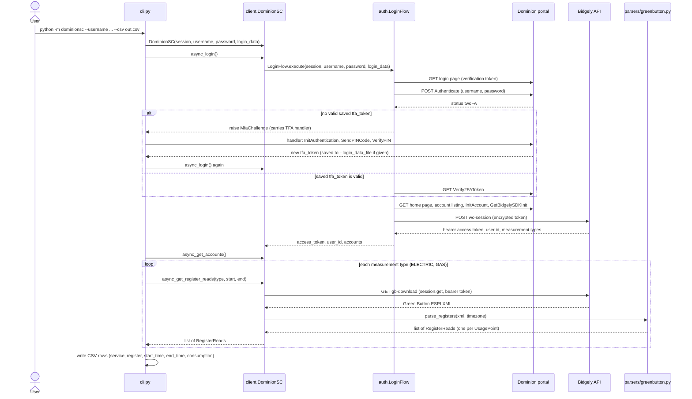
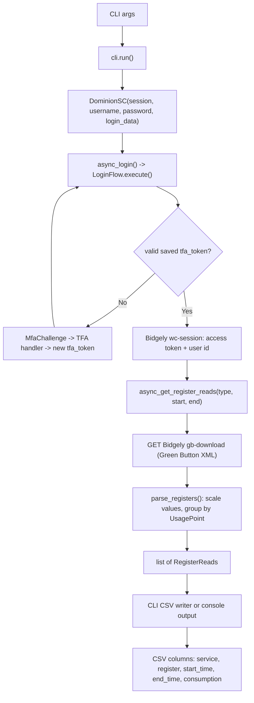
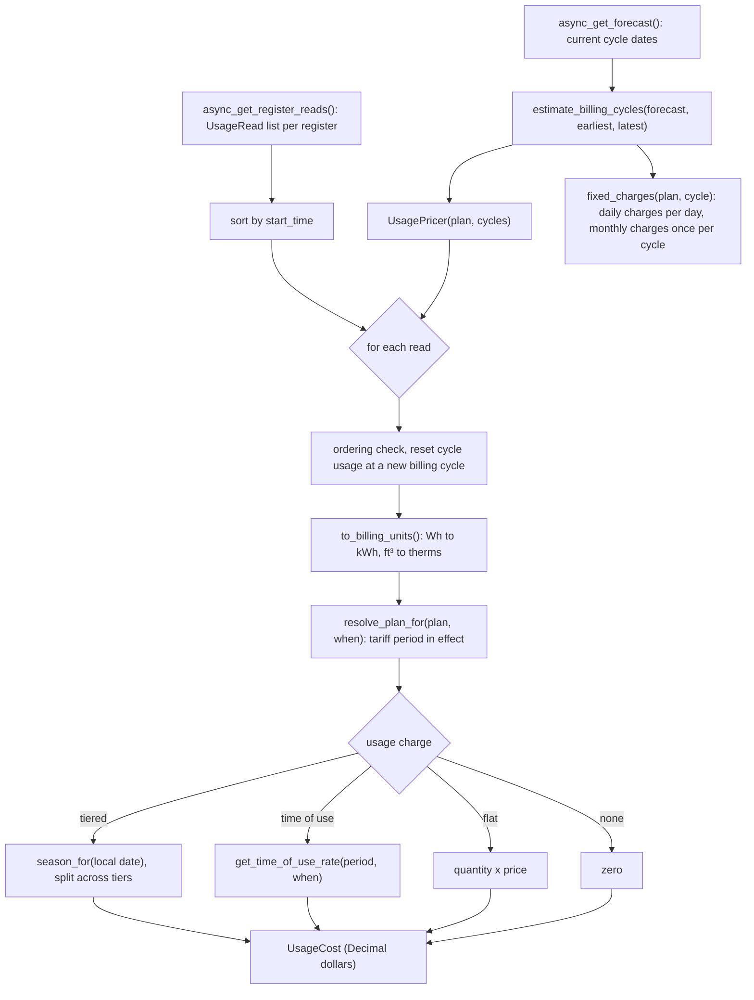

# Data Flow & Sequence Architecture

## Request Sequence (CLI -> APIs -> Parser -> CSV)

This is the flow for `python -m dominionsc --csv output.csv`. Without `--csv`, the CLI also fetches and prints the forecast and prints readings to the console instead of writing a file.

All Dominion and Bidgely login and forecast calls go through `DominionSCURLHandler.call_api()` in `transport.py`. Usage reads (`gb-download`) call `session.get` directly, a known inconsistency documented in `transport.py` and the developer guide.

## Data Flow Diagram (Flowchart)

## Response Parsing Flow (Grounded)

- **Historical:** `parsers/greenbutton.py` parses ESPI XML. Days whose data isn't available yet are absent from the feed, not returned as zero-valued readings. Registers are separated by `UsagePoint` id (see `register_reads.py`) and returned in first-seen order. Negative values are preserved (a solar-export register may report them). Raw values are multiplied by the feed's declared `powerOfTenMultiplier` (`10 ** multiplier`), which is what converts Dominion's gas readings to cubic feet; electric feeds declare none. Each read's `unit` comes from the feed's `espi:uom` (72 is Wh, 119 is ft³); an unknown or conflicting code leaves it `None` and logs one warning.
- **Forecast:** `DominionSC.async_get_forecast()` fetches the portal home page (for a fresh verification token), then the `GetAccountAMIUsageAlerts` endpoint; `parsers/forecast.py` turns the JSON into a `Forecast` (`models/forecast.py`).

## Pricing Flow

Pricing is pure computation on data the caller already has; it makes no network calls. A consumer such as
`ha-dominion-sc` fetches reads and the forecast, then prices them:

`price_usage()` and `rate_at()` follow the same path for a single interval or moment, and `price_net_usage()` /
`UsagePricer.price_net()` price a grid read and a solar-export read for the same interval separately and net them.

