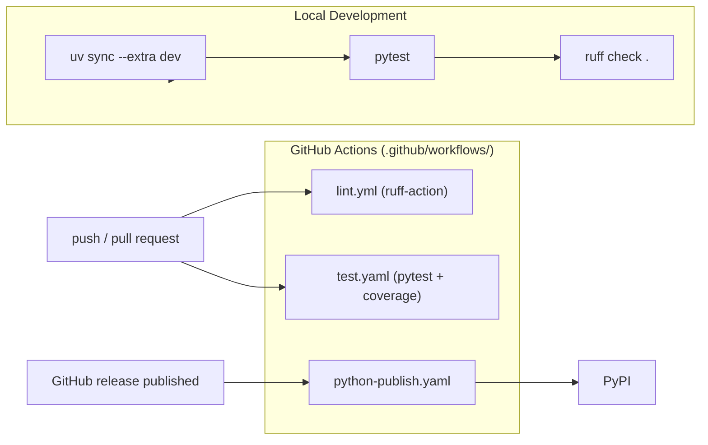
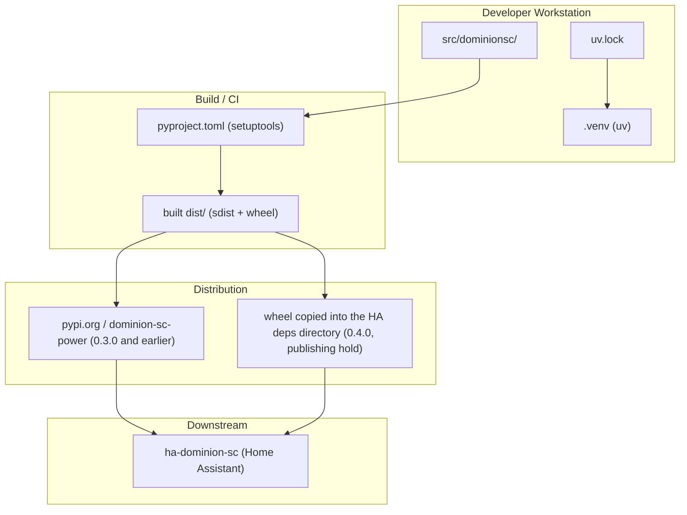

# Deployment & Packaging Architecture

## Build & Package Structure (Grounded)

- `pyproject.toml` — package metadata, runtime dependencies (`aiohttp`, `tzdata`, `xmltodict`), the `dev` optional extra, build-system (`setuptools`), package data (`py.typed`), and tool configs (`ruff`, `pytest`, `mypy`, coverage).
- `uv.lock` — reproducible lockfile (committed).
- `.venv/` — virtualenv managed by `uv`; not committed (`.gitignore`).
- `scripts/setup` — creates or updates `.venv` with `uv sync --extra dev`; `scripts/lint` and `scripts/test` wrap Ruff and pytest.
- `src/dominionsc/` — source layout (not flat).

## CI/CD Pipeline Diagram

## Deployment / Environment Diagram

Releases are tagged on the fork (`hype8912/dominion-sc-power`, for example `v0.4.0`). While the PyPI publishing hold
is in place, don't create a GitHub release: `python-publish.yaml` publishes to PyPI when one is published. The
integration's maintainer installs the wheel built with `uv build` into the Home Assistant instance's `deps`
directory by hand.

## Test Strategy (Grounded)

- `tests/` directory present; `pytest` (with `pytest-asyncio` in `auto` mode) is used, with fixtures in `tests/fixtures/`. Fixtures made from real API captures are redacted (account, customer, meter and document ids replaced with `REDACTED_*`).
- `tests/legacy/` holds a frozen copy of `ha-dominion-sc`'s 0.3.0-era pricing. `test_billing.py`'s equivalence test (marked `slow`) prices 16 months of synthetic reads for every catalog plan through both and requires them to agree within 1e-9 USD. Delete the package once the integration has migrated.
- Every module is held at 100% line and branch coverage.
- Coverage is reported through `pytest-cov`; the HTML report is written to `htmlcov/`, which is not committed.
- `test.yaml` runs on push and pull request, on Python 3.14.
- `lint.yml` runs `ruff check` and `ruff format --check` on push and pull request through `astral-sh/ruff-action`, which installs Ruff itself (no Python setup or package install).
- `python-publish.yaml` builds the distributions and publishes them to PyPI when a GitHub release is published.
- The test and publish jobs install with pip; local development uses uv.
